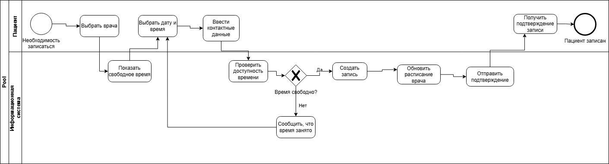

# Разработка концепции информационной системы «МедЗапись»

**Дисциплина:** Проектирование информационных систем  
**Практическая работа:** Разработка концепции информационной системы  
**Вариант:** № 9 — Запись пациентов в частную клинику  

## Состав команды

- Участник 1 — руководитель проекта, системный аналитик.
- Участник 2 — архитектор информационной системы, специалист по информационной безопасности.

## Содержание

1. Характеристика объекта автоматизации и требования пользователя
2. Аналитический обзор аналогов и готовых решений
3. Альтернативные варианты концепции ИС
4. Сравнение вариантов и обоснование выбора
5. Описание выбранной концепции и модель процессов TO-BE
6. Ожидаемые эффекты и технико-экономическое обоснование
7. Реестр рисков и меры реагирования
8. Порядок оценки качества и условия приёмки
9. Выводы

## 1. Характеристика объекта автоматизации и требования пользователя

### 1.1. Описание объекта автоматизации

В данной работе рассматривается разработка концепции информационной системы «МедЗапись» для частной медицинской клиники.

Клиника оказывает медицинские услуги и ведёт приём пациентов по предварительной записи. В ней работают 10 врачей различных специальностей и 2 администратора. В среднем клинику посещают 50 пациентов в день.

Объектом автоматизации является процесс записи пациентов на приём к врачу, включая выбор специалиста, проверку свободного времени, создание, перенос и отмену записи.

В настоящее время запись пациентов осуществляется по телефону или при личном обращении в регистратуру. Администраторы ведут расписание в электронных таблицах, что создаёт дополнительную нагрузку и может приводить к ошибкам.

Цель создания информационной системы — упростить запись пациентов, сократить время обработки заявок и повысить удобство работы сотрудников клиники.

### 1.2. Исходные данные и ограничения

Для выполнения практической работы используются следующие условные данные:

| Параметр | Значение |
|---|---|
| Количество врачей | 10 |
| Количество администраторов | 2 |
| Среднее количество пациентов в день | 50 |
| Рабочих дней в месяц | 22 |
| Максимальный бюджет внедрения | 500 000 руб. |
| Максимальный срок внедрения | 4 месяца |
| Размещение данных | Серверы на территории РФ |

Все приведённые значения являются учебными допущениями и используются для сравнения вариантов реализации и экономических расчётов.

### 1.3. Участники процесса

В процессе записи пациентов участвуют четыре основные группы пользователей:

1. **Пациент** — выбирает врача, просматривает свободное время, записывается на приём, переносит или отменяет запись.
2. **Администратор** — управляет расписанием, записывает пациентов по телефону и помогает решать возникающие проблемы.
3. **Врач** — просматривает своё расписание и информацию о предстоящих приёмах.
4. **Руководитель клиники** — контролирует загруженность врачей и получает статистику посещений.

### 1.4. Описание текущего процесса AS-IS

В настоящее время запись пациента происходит следующим образом:

1. Пациент звонит в клинику или приходит лично.
2. Администратор уточняет, к какому врачу необходимо записаться.
3. Администратор открывает таблицу с расписанием.
4. Проверяет наличие свободного времени.
5. Согласовывает дату и время с пациентом.
6. Вносит данные пациента в таблицу.
7. Сообщает пациенту информацию о записи.

Если пациент хочет перенести или отменить приём, ему необходимо повторно связаться с регистратурой.

### 1.5. Проблемы существующего процесса

При анализе текущего процесса были выделены следующие проблемы:

1. Пациенты не могут самостоятельно записываться через интернет.
2. В часы высокой нагрузки администраторам сложно обрабатывать все звонки.
3. При ручном ведении расписания возможны ошибки и двойные записи.
4. Пациенты могут забывать о назначенном приёме.
5. Перенос и отмена записи требуют участия администратора.
6. Проверка свободного времени врачей занимает дополнительное время.
7. Руководителю сложно получать актуальную статистику загруженности специалистов.

### 1.6. Функциональные требования

Разрабатываемая система должна обеспечивать следующие функции:

| ID | Требование | Приоритет |
|---|---|---|
| FR-01 | Просмотр списка врачей и их специализаций | Must |
| FR-02 | Просмотр доступных дат и времени приёма | Must |
| FR-03 | Онлайн-запись пациента к врачу | Must |
| FR-04 | Отмена и перенос записи | Must |
| FR-05 | Предотвращение двойного бронирования | Must |
| FR-06 | Просмотр и изменение расписания администратором | Must |
| FR-07 | Просмотр расписания врачом | Must |
| FR-08 | Отправка напоминаний пациентам | Should |
| FR-09 | Просмотр истории посещений | Should |
| FR-10 | Формирование отчётов о загруженности врачей | Should |

Must — обязательное требование, без которого вариант реализации не подходит.

Should — желательное требование, которое повышает удобство системы, но может быть реализовано позже.

### 1.7. Нефункциональные требования

| ID | Требование | Приоритет |
|---|---|---|
| NFR-01 | Время отклика основных операций не более 3 секунд при штатной нагрузке | Should |
| NFR-02 | Работа через браузер компьютера и смартфона | Must |
| NFR-03 | Разграничение доступа по ролям пользователей | Must |
| NFR-04 | Защита персональных данных согласно 152-ФЗ | Must |
| NFR-05 | Регулярное резервное копирование данных | Must |
| NFR-06 | Доступность системы не менее 99% в месяц | Should |
| NFR-07 | Понятный интерфейс без необходимости специального обучения пациентов | Should |

### 1.8. Основные ограничения проекта

При разработке концепции необходимо учитывать следующие ограничения:

- Бюджет внедрения системы не должен превышать 500 000 рублей.
- Срок внедрения составляет не более 4 месяцев.
- Персональные данные пациентов должны обрабатываться с соблюдением законодательства РФ.
- Размещение баз данных с персональными данными предусматривается на серверах в России.
- Система должна поддерживать работу 10 врачей и 2 администраторов, а также онлайн-запись пациентов.
- При выборе варианта реализации необходимо учитывать дальнейшие расходы на обслуживание системы.

### 1.9. Результат первого этапа

В результате анализа были определены основные проблемы существующего процесса записи пациентов и сформулированы требования к будущей информационной системе.

Основной задачей системы «МедЗапись» является автоматизация записи пациентов с возможностью самостоятельного выбора врача и времени приёма.

На следующем этапе будут рассмотрены существующие программные решения, которые могут использоваться для автоматизации данного процесса.

## 2. Аналитический обзор аналогов и готовых решений

### 2.1. Обзор существующих систем

Для разработки концепции «МедЗапись» были рассмотрены четыре существующие информационные системы, которые используются для автоматизации работы медицинских организаций.

**1. MEDODS**

Медицинская информационная система для частных клиник. Позволяет вести расписание врачей, записывать пациентов, работать с электронными медицинскими картами и отправлять уведомления. Поддерживает интеграции с другими сервисами и API.

Доступны облачная и локальная версии. Стоимость облачной версии начинается от 6 900 руб. в месяц за два рабочих места. Дополнительные функции и рабочие места могут оплачиваться отдельно.

**2. Клиентикс**

Система для управления частными клиниками, объединяющая функции МИС и CRM. Поддерживает запись пациентов, управление расписанием, уведомления, работу с документами и формирование отчётов.

Предоставляется в виде облачного сервиса. Стоимость зависит от выбранного тарифа, количества филиалов и посещений пациентов.

**3. БИТ.Управление медицинским центром**

Программа для автоматизации медицинских центров на базе платформы 1С. Позволяет вести журнал записи пациентов, управлять графиками врачей, учитывать оказанные услуги и формировать отчётность.

Стоимость основной поставки на одно рабочее место составляет 34 200 руб. Для использования необходима платформа 1С:Предприятие и соответствующие лицензии. Дополнительные функции могут потребовать отдельных затрат.

**4. Инфоклиника**

Медицинская информационная система для автоматизации работы клиник. Предназначена для ведения расписания, регистрации пациентов, работы с медицинской документацией и управления деятельностью медицинской организации.

Стоимость и условия внедрения необходимо уточнять у поставщика.

### 2.2. Сравнение аналогов

| Критерий | MEDODS | Клиентикс | БИТ.УМЦ | Инфоклиника |
|---|---|---|---|---|
| Запись пациентов | Есть | Есть | Есть | Есть |
| Расписание врачей | Есть | Есть | Есть | Есть |
| Онлайн-запись | Есть, отдельный модуль | Есть | Зависит от комплектации | Требует уточнения |
| Напоминания | Есть, отдельные услуги | Есть | Требует уточнения | Требует уточнения |
| Отчётность | Есть | Есть | Есть | Есть |
| Модель лицензирования | Подписка или локальная лицензия | Облачная подписка | Лицензия на базе 1С | Уточняется |
| Стоимость | От 6 900 руб./мес. | По тарифу и объёму использования | От 34 200 руб. + 1С | По запросу |
| Интеграции | API, телефония, лаборатории | API, внешние сервисы | Экосистема 1С | Требует уточнения |
| Размещение данных | Облако или локально | Облако | Зависит от внедрения | Требует уточнения |

Указанные цены являются опубликованными базовыми условиями, а не итоговой стоимостью внедрения в нашу клинику. Для выполнения всех требований могут понадобиться дополнительные модули, лицензии и настройка.

### 2.3. Вывод по обзору

Рассмотренные системы позволяют автоматизировать основные процессы медицинской клиники, но отличаются стоимостью, функциональностью и условиями внедрения.

MEDODS и Клиентикс подходят для использования готового облачного решения. БИТ.Управление медицинским центром может быть полезна организациям, которые уже работают с платформой 1С.

При этом для небольшой клиники не все возможности комплексных медицинских систем являются необходимыми. Поэтому далее будут рассмотрены три варианта: улучшение существующего процесса без новой системы, внедрение готового решения и собственная разработка.

### 2.4. Источники

1. MEDODS — https://www.medods.ru/
2. MEDODS, тарифы — https://product-develop.medods.ru/pricing
3. Клиентикс — https://klientiks.ru/
4. БИТ.Управление медицинским центром — https://bit-medic.ru/products/bit-upravlenie-meditsinskim-tsentrom/
5. Инфоклиника — https://sdsys.ru/
6. Документация Инфоклиника — https://help.infoclinica.ru/26.1/sait_main_2/

## 3. Альтернативные варианты концепции ИС

Для автоматизации записи пациентов в частную клинику рассмотрим три варианта решения:

- Вариант A — улучшение существующего процесса без разработки новой ИС.
- Вариант B — внедрение готовой медицинской информационной системы.
- Вариант C — собственная разработка веб-приложения «МедЗапись».

Все варианты рассматриваются для клиники с 10 врачами, 2 администраторами и средним количеством 50 пациентов в день.

Стоимость и сроки являются предварительными учебными оценками. Они используются для сравнения вариантов и не являются коммерческими предложениями.

### 3.1. Вариант A — организационное решение

Данный вариант предполагает улучшение существующего процесса без внедрения новой информационной системы.

Для работы используются электронные таблицы с расписанием врачей, телефонная связь и единый регламент обработки записей.

**Основные изменения:**

- Создание общей таблицы расписания врачей.
- Использование единого шаблона регистрации пациентов.
- Назначение ответственного администратора за актуальность расписания.
- Введение правил переноса и отмены записей.
- Ежедневная проверка расписания и подготовка статистики.

**Техническая основа:** существующие компьютеры, офисные программы и защищённое файловое хранилище с разграничением доступа.

**Ресурсы:** один администратор и один сотрудник, отвечающий за настройку таблиц и обучение персонала.

**Предварительная стоимость внедрения:** 20 000 руб.

**Ежегодные расходы:** 12 000 руб.

**Срок внедрения:** 2 недели.

**Преимущества:**

- Низкая стоимость.
- Быстрое внедрение.
- Не требуется разработка программного обеспечения.
- Сотрудникам не нужно осваивать сложную систему.

**Недостатки:**

- Пациенты не смогут самостоятельно записываться через интернет.
- Сохраняется зависимость от администраторов.
- Остаётся риск ошибок при ручном заполнении.
- Нет автоматических напоминаний.
- Возможности дальнейшего развития ограничены.

Вариант A рассматривается как базовый для сравнения, но не выполняет обязательное требование онлайн-записи пациентов.

### 3.2. Вариант B — внедрение готовой медицинской информационной системы

Данный вариант предполагает использование существующей медицинской информационной системы, например MEDODS, с настройкой под потребности клиники.

Система будет использоваться для ведения расписания врачей, записи пациентов, отмены и переноса приёмов, а также получения статистики.

**Основные функции:**

- Онлайн-запись пациентов.
- Просмотр расписания врачей.
- Создание, изменение и отмена записей.
- Предотвращение двойного бронирования.
- Разграничение прав пользователей.
- Отправка напоминаний.
- Формирование отчётов.

**Техническая основа:** готовое облачное программное обеспечение с доступом через браузер и подключаемыми модулями онлайн-записи.

**Ресурсы:** один специалист по настройке системы, администратор клиники и представитель поставщика.

**Предварительная стоимость внедрения:** 100 000 руб.

**Ежегодные расходы:** 180 000 руб.

**Срок внедрения:** 1 месяц.

В расчёт включены условные затраты на настройку, подключение необходимых функций, обучение сотрудников и техническую поддержку. Ежегодная сумма является оценкой полного комплекта услуг для учебного проекта, а не опубликованным тарифом поставщика.

**Преимущества:**

- Быстрое внедрение.
- Основные функции уже разработаны.
- Наличие технической поддержки.
- Возможность дальнейшего расширения.
- Меньше рисков, связанных с самостоятельной разработкой.

**Недостатки:**

- Постоянные расходы на подписку.
- Зависимость от поставщика.
- Ограниченные возможности изменения функциональности.
- Необходимо проверить соответствие требованиям к защите и размещению персональных данных.

Вариант B является одним из основных кандидатов для внедрения.

### 3.3. Вариант C — собственная разработка системы «МедЗапись»

Данный вариант предполагает создание собственного веб-приложения, предназначенного специально для рассматриваемой клиники.

Система будет включать интерфейс пациента, рабочее место администратора, расписание врачей и базу данных записей.

**Основные функции:**

- Просмотр списка врачей.
- Выбор даты и времени приёма.
- Создание записи через сайт.
- Перенос и отмена записи.
- Проверка доступности времени.
- Просмотр расписания сотрудниками.
- Разграничение прав доступа.
- Уведомления пациентов.
- Формирование статистики.

**Техническая основа:**

- Frontend — HTML, CSS, JavaScript.
- Backend — Python с использованием Django.
- База данных — PostgreSQL.
- Размещение — сервер на территории РФ.
- Архитектура — клиент-серверное веб-приложение.

Для предотвращения двойного бронирования предусматривается проверка доступности времени и ограничение уникальности записи на уровне базы данных.

**Ресурсы:** два разработчика, системный аналитик и тестировщик. Отдельные роли могут совмещаться.

**Предварительная стоимость разработки и внедрения:** 450 000 руб.

**Ежегодные расходы:** 90 000 руб.

**Срок внедрения:** 4 месяца.

В стоимость включаются разработка, тестирование, настройка сервера и первоначальное обучение сотрудников. Оценка предполагает небольшой объём функций и совмещение ролей участниками проекта.

**Преимущества:**

- Система разрабатывается под требования конкретной клиники.
- Возможность самостоятельно изменять и расширять функциональность.
- Меньшая зависимость от внешнего поставщика.
- Возможность самостоятельно контролировать размещение данных.

**Недостатки:**

- Высокая стоимость первоначальной разработки.
- Более длительный срок внедрения.
- Необходимость самостоятельно обеспечивать поддержку и обновления.
- Риски ошибок и задержек разработки.
- Дополнительная ответственность за информационную безопасность.

Вариант C выполняет основные функциональные требования на уровне проектной концепции, однако его реализация требует больше времени и ресурсов.

### 3.4. Сравнение ресурсов и характеристик вариантов

| Параметр | Вариант A | Вариант B | Вариант C |
|---|---|---|---|
| Идея | Улучшение текущего процесса | Готовая МИС | Собственная разработка |
| Онлайн-запись | Нет | Да | Да |
| Управление расписанием | Вручную | Автоматизировано | Автоматизировано |
| Напоминания | Нет | Да, при подключении | Предусмотрены |
| Архитектура | Таблицы и регламент | Готовая облачная система | Клиент-серверное приложение |
| Команда внедрения | 2 человека | 2–3 человека | 4 роли с совмещением |
| Трудоёмкость | 0,5 чел.-мес. | 1,5 чел.-мес. | 12 чел.-мес. |
| Стоимость создания/внедрения | 20 000 руб. | 100 000 руб. | 450 000 руб. |
| Эксплуатация в год | 12 000 руб. | 180 000 руб. | 90 000 руб. |
| Срок внедрения | 0,5 месяца | 1 месяц | 4 месяца |
| Зависимость от поставщика | Низкая | Высокая | Низкая |
| Основной недостаток | Нет онлайн-записи | Расходы на подписку | Дорогая разработка |

Трудоёмкость указана в человеко-месяцах и является оценочной.

### 3.5. Предварительный вывод

Все три варианта имеют свои преимущества и недостатки.

Вариант A является самым дешёвым, но не обеспечивает полноценную онлайн-запись пациентов и не соответствует всем обязательным требованиям.

Вариант B позволяет быстро внедрить необходимые функции без самостоятельной разработки.

Вариант C обеспечивает большую гибкость, но требует значительных первоначальных затрат.

На следующем этапе будет проведено сравнение вариантов методом взвешенных оценок. При этом варианты, не выполняющие обязательные требования Must, не могут быть выбраны в качестве итогового решения.

## 4. Сравнение вариантов и обоснование выбора

### 4.1. Критерии оценки

Для выбора оптимального варианта информационной системы используется метод взвешенных оценок.

Каждый вариант оценивается по шкале от 1 до 5, где 1 — наихудшая оценка, а 5 — наилучшая. Для каждого критерия задаётся вес, который показывает его важность. Сумма всех весов равна 1.

Для учебного проекта приняты следующие веса:

| Критерий | Вес |
|---|---:|
| Покрытие требований | 0,30 |
| Стоимость владения за 3 года | 0,20 |
| Срок внедрения | 0,15 |
| Возможности интеграции | 0,10 |
| Безопасность данных | 0,15 |
| Масштабируемость | 0,05 |
| Независимость от поставщика | 0,05 |
| **Итого** | **1,00** |

Наиболее важными критериями являются покрытие требований, стоимость владения и безопасность персональных данных.

### 4.2. Проверка обязательных требований

Перед сравнением необходимо проверить соответствие вариантов обязательным требованиям Must.

Обозначения: «+» — выполняется, «−» — не выполняется, «±» — выполнение требует дополнительной настройки или проверки.

| Обязательное требование | A | B | C |
|---|:---:|:---:|:---:|
| Просмотр врачей и специализаций | ± | + | + |
| Просмотр свободного времени | ± | + | + |
| Онлайн-запись пациента | − | + | + |
| Отмена и перенос записи | ± | + | + |
| Предотвращение двойной записи | − | + | + |
| Управление расписанием | + | + | + |
| Просмотр расписания врачом | ± | + | + |
| Работа через браузер и смартфон | ± | + | + |
| Разграничение прав доступа | ± | + | + |
| Соблюдение требований 152-ФЗ | ± | ± | ± |
| Резервное копирование | ± | + | + |

Вариант A не выполняет обязательные требования онлайн-записи и автоматического предотвращения двойного бронирования, поэтому исключается из окончательного выбора.

Для вариантов B и C соблюдение требований законодательства о персональных данных должно быть подтверждено при внедрении и проверке системы.

### 4.3. Расчёт стоимости владения за три года

Совокупная стоимость владения (TCO) рассчитывается как сумма первоначальных затрат и расходов на эксплуатацию за три года.

TCO = Cсозд + 3 × Cэкспл

**Вариант A:**

TCO(A) = 20 000 + 3 × 12 000 = 56 000 руб.

**Вариант B:**

TCO(B) = 100 000 + 3 × 180 000 = 640 000 руб.

**Вариант C:**

TCO(C) = 450 000 + 3 × 90 000 = 720 000 руб.

| Вариант | Первоначальные затраты | Эксплуатация за 3 года | TCO |
|---|---:|---:|---:|
| A | 20 000 | 36 000 | 56 000 |
| B | 100 000 | 540 000 | 640 000 |
| C | 450 000 | 270 000 | 720 000 |

Несмотря на более высокие ежегодные расходы, вариант B имеет меньшую стоимость владения за три года по сравнению с собственной разработкой.

### 4.4. Таблица взвешенных оценок

Оценки назначены экспертным способом на основе характеристик вариантов и принятых учебных ограничений.

| Критерий | Вес | A | B | C |
|---|---:|---:|---:|---:|
| Покрытие требований | 0,30 | 2 | 5 | 5 |
| Стоимость владения за 3 года | 0,20 | 5 | 4 | 3 |
| Срок внедрения | 0,15 | 5 | 5 | 2 |
| Возможности интеграции | 0,10 | 1 | 4 | 5 |
| Безопасность данных | 0,15 | 2 | 4 | 4 |
| Масштабируемость | 0,05 | 1 | 4 | 5 |
| Независимость от поставщика | 0,05 | 5 | 2 | 5 |
| **Итоговая оценка** | **1,00** | **3,05** | **4,35** | **4,00** |

Итоговая оценка рассчитывается как сумма произведений веса каждого критерия на оценку варианта.

Для варианта A:

S(A) = 0,30 × 2 + 0,20 × 5 + 0,15 × 5 + 0,10 × 1 + 0,15 × 2 + 0,05 × 1 + 0,05 × 5 = 3,05.

Для варианта B:

S(B) = 0,30 × 5 + 0,20 × 4 + 0,15 × 5 + 0,10 × 4 + 0,15 × 4 + 0,05 × 4 + 0,05 × 2 = 4,35.

Для варианта C:

S(C) = 0,30 × 5 + 0,20 × 3 + 0,15 × 2 + 0,10 × 5 + 0,15 × 4 + 0,05 × 5 + 0,05 × 5 = 4,00.

По результатам расчётов вариант B получает наибольшую оценку.

### 4.5. Проверка устойчивости выбора

Для проверки устойчивости изменим вес наиболее значимого критерия «Покрытие требований» с 0,30 до 0,25, а вес критерия «Стоимость владения» увеличим с 0,20 до 0,25.

Новые веса:

| Критерий | Вес |
|---|---:|
| Покрытие требований | 0,25 |
| Стоимость владения | 0,25 |
| Срок внедрения | 0,15 |
| Интеграция | 0,10 |
| Безопасность | 0,15 |
| Масштабируемость | 0,05 |
| Независимость от поставщика | 0,05 |
| **Итого** | **1,00** |

После пересчёта:

- S(A) = 3,20.
- S(B) = 4,30.
- S(C) = 3,90.

Вариант B сохраняет наибольшую оценку. Следовательно, выбор устойчив к рассмотренному изменению весов.

### 4.6. Обоснование выбранного варианта

По результатам сравнения выбран вариант B — внедрение готовой медицинской информационной системы.

Он соответствует основным функциональным требованиям, позволяет внедрить онлайн-запись пациентов за короткий срок и не требует самостоятельной разработки программного обеспечения.

По сравнению с вариантом C он имеет меньшую совокупную стоимость владения за три года и более короткий срок внедрения.

Вариант A исключён из окончательного выбора, поскольку не выполняет обязательные требования.

В качестве базового готового решения для дальнейшего проектирования рассматривается MEDODS. Перед заключением договора необходимо подтвердить стоимость полного комплекта функций, возможности интеграции, условия размещения данных и соответствие требованиям информационной безопасности.

Таким образом, для рассматриваемой клиники наиболее целесообразно внедрение готовой системы с настройкой под существующие процессы.

## 5. Описание выбранной концепции и модель процессов TO-BE

### 5.1. Описание выбранного решения

По результатам сравнения выбран вариант B — внедрение готовой медицинской информационной системы.

В качестве базового решения рассматривается MEDODS, которую планируется настроить под потребности частной клиники.

Основная задача внедрения — предоставить пациентам возможность самостоятельно записываться к врачу через интернет и уменьшить нагрузку на администраторов.

Система должна обеспечивать ведение расписания врачей, создание и изменение записей, проверку свободного времени и отправку уведомлений.

### 5.2. Участники и границы системы

В работе системы участвуют пациент, администратор, врач и руководитель клиники.

**Автоматизируемые действия:**

- Отображение списка врачей и доступного времени.
- Проверка свободных интервалов.
- Создание, перенос и отмена записи.
- Проверка отсутствия двойного бронирования.
- Отправка подтверждений и напоминаний.
- Обновление расписания врачей.
- Формирование статистики записей.

**Действия, которые остаются ручными:**

- Проведение медицинского приёма.
- Решение нестандартных ситуаций администратором.
- Изменение рабочего графика по согласованию с руководством.
- Помощь пациентам, которые не могут самостоятельно записаться через интернет.

### 5.3. Описание целевого процесса TO-BE

После внедрения информационной системы процесс записи пациента будет происходить следующим образом:

1. Пациент открывает сайт клиники.
2. Выбирает нужного врача или специальность.
3. Система показывает доступные даты и время.
4. Пациент выбирает удобный интервал.
5. Вводит необходимые контактные данные.
6. Система проверяет, что выбранное время ещё свободно.
7. Если время занято, система предлагает выбрать другой интервал.
8. Если время свободно, система создаёт запись.
9. Пациент получает подтверждение.
10. Запись автоматически появляется в расписании врача и администратора.
11. Перед приёмом система отправляет пациенту напоминание.

При отмене или переносе записи пациент сможет выполнить действие самостоятельно через интерфейс системы. Освободившееся время снова становится доступным для записи.

### 5.4. Изменения по сравнению с AS-IS

| Проблема AS-IS | Решение TO-BE |
|---|---|
| Запись только по телефону или лично | Онлайн-запись через сайт |
| Большая нагрузка на регистратуру | Самостоятельная запись пациентов |
| Возможность двойной записи | Автоматическая проверка свободного времени |
| Пациенты забывают о приёме | Автоматические напоминания |
| Перенос записи через администратора | Самостоятельный перенос и отмена |
| Ручная проверка расписания | Автоматическое отображение свободных интервалов |
| Сложно получить статистику | Формирование отчётов |

### 5.5. Модель процесса TO-BE в нотации BPMN 2.0

Целевой процесс записи пациента представлен на BPMN-диаграмме.

Диаграмма включает три дорожки: пациент, информационная система и администратор.

Основной процесс начинается с выбора врача пациентом. Система отображает свободное время и проверяет возможность записи. Если выбранный интервал доступен, запись сохраняется и пациент получает подтверждение. Если интервал уже занят, пациент выбирает другое время.

Администратор участвует в процессе только при возникновении ситуации, требующей ручного решения.

### 5.6. Ожидаемый результат внедрения

После внедрения системы пациенты смогут самостоятельно записываться на приём, а администраторы будут тратить меньше времени на обработку заявок.

Автоматическая проверка расписания позволит исключить двойное бронирование одного временного интервала, а напоминания помогут уменьшить количество пропущенных приёмов.

Таким образом, внедрение готовой медицинской информационной системы позволит сделать процесс записи более удобным и сократить количество ручных операций.
